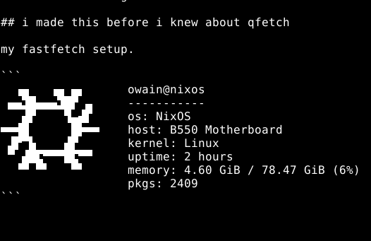

# fastfetch-config



## install

```sh
curl -fsSL https://raw.githubusercontent.com/epwv/fastfetch-config/main/install.sh | bash
```

backs up your existing config if you have one, then drops `config.jsonc` into `~/.config/fastfetch/`.

## manual install

```sh
cp config.jsonc ~/.config/fastfetch/config.jsonc
```

## why

i like it
